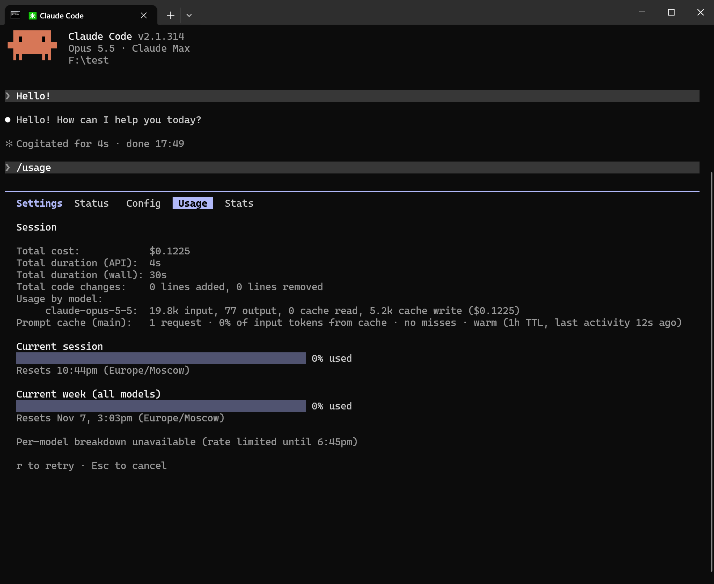

# ClaudGravityNext

**Use Claude Code (and any Anthropic-API client) with Gemini models — through a small gateway you run yourself.**

ClaudGravityNext speaks the Anthropic Messages API on the front and Gemini on the back.
Point your client at it, and tools, thinking, images, PDFs and streaming keep working. It is
a single Go binary with a built-in web dashboard. No database to set up, no Docker required.

```
Claude Code ──▶  ClaudGravityNext  ──▶  Gemini
 (Anthropic API)   translate · pool · retry
```



*Claude Code talking to Gemini through the gateway: the normal chat, and `/usage` with its usage bars and prompt-cache status.*

## Why you might want it

- **Drop-in for Claude Code.** `ANTHROPIC_BASE_URL` plus a key, nothing else to patch.
- **Many accounts, one endpoint.** Requests are spread across your account pool, with
  quota-aware cooldowns and automatic failover when one account runs dry.
- **Tool use that holds up.** Tool schemas are translated, malformed arguments repaired,
  long MCP tool names shortened and restored.
- **Cache-friendly.** The request prefix is kept deterministic so prompt caching works, and
  `max_tokens: 0` pre-warms it.
- **Effort levels.** `low`, `medium`, `high`, `xhigh`, `max` map to thinking budgets.
- **Wire-compatible.** SSE grammar, usage numbers, stop reasons and error types follow the
  Anthropic API, so clients don't need special cases.
- **Dashboard.** Add accounts, create API keys, watch quotas and logs in the browser.
- **Safe defaults.** Secrets are generated on first run, SSRF-guarded URL downloads, upstream
  error details are sanitized before they reach clients.

## Quick start

You need [Go](https://go.dev/dl/) (version in `go.mod`) and a Google account to log in with.

**1. Build**

```
go build -o gateway_v2 ./cmd/gateway
```

**2. Configure**

```
cp config.example.json config.json
```

Open `config.json` and change one thing: rename the key `sk-change-me` under `tenants` to a
random string of your own (for example `sk-` plus 32 hex characters). That string is the API
key your clients will send. Leave `dashboard_password` and `proxy_secret` empty — they are
generated and saved on first start.

**3. Run**

```
./gateway_v2 -config config.json -auths auths -ca-dir ca
```

**4. Add an account**

Open <http://localhost:8898/> (user `admin`, password = `dashboard_password` from
`config.json`) and sign in with Google from the dashboard. Credentials are stored in `auths/`.

> The Google sign-in redirects back to `http://localhost:8898/oauth/callback`, so
> keep `server.port` at `8898` and do the login on the machine where the gateway runs
> (or forward that port to it). The login also needs a Google OAuth client secret:
> set `server.google_oauth_client_secret` (and `google_oauth_client_id` if you use your
> own client) in `config.json`.

**5. Use it from Claude Code**

The easiest way is the [client installer](#one-line-client-setup-optional) below: it writes
this whole environment into a launcher for you. To set it up by hand, define **all** of these
in the shell that starts `claude` (every one is required; this is exactly what the installer
writes):

| Variable | Value | Why |
|---|---|---|
| `CLAUDE_CONFIG_DIR` | a new empty folder, e.g. `~/.claudgravitynext/profile` | Separate profile, so the session shares no login or history with a real Claude account. |
| `ANTHROPIC_BASE_URL` | `http://localhost:8898` | Where the gateway listens, plain HTTP on the API port. For a gateway on another machine use `http://<host>:<port>` (see below). |
| `CLAUDE_CODE_OAUTH_TOKEN` | your tenant key (`sk-...` from `config.json`) | Used instead of `ANTHROPIC_AUTH_TOKEN`, so Claude Code runs in its signed-in mode. |
| `CLAUDE_CODE_OAUTH_SCOPES` | `user:inference user:profile` | Describes the (fake) signed-in account. |
| `CLAUDE_CODE_SUBSCRIPTION_TYPE` | `max` | Same: enables the normal feature set. |
| `CLAUDE_CODE_RATE_LIMIT_TIER` | `default` | Same. |
| `_CLAUDE_CODE_ASSUME_FIRST_PARTY_BASE_URL` | `1` | Treat the custom URL as the official API: the client calls the profile/usage endpoints the gateway answers (usage bars, startup checks) and keeps the prompt cache warm. |
| `CLAUDE_CODE_GATEWAY_HINT_HEADERS` | `1` | Claude Code labels each request (main / subagent / helper). Without it every helper call (titles, summaries) is treated as heavy and can stall for 20-60 s. |
| `CLAUDE_CODE_ATTRIBUTION_HEADER` | `0` | Drops the per-request attribution block, which would change the prompt prefix and break caching. |
| `CLAUDE_CODE_ENABLE_TODO_TOOLS` | `1` | Keeps the todo tools available. |
| `CLAUDE_CODE_EFFORT_LEVEL` | `xhigh` | Default effort (`low` ... `max`), mapped to a thinking budget. |
| `DISABLE_AUTOUPDATER` | `1` | The client must not replace itself with a build you did not test. |
| `CLAUDE_CODE_USE_POWERSHELL_TOOL` | `1` (Windows with PowerShell only) | Shell tool selection on Windows. |
| `HTTP_PROXY`, `HTTPS_PROXY`, `ALL_PROXY`, `ANTHROPIC_AUTH_TOKEN`, `ANTHROPIC_API_KEY`, `CLAUDE_CODE_SIMPLE` | **set to an empty value** (not just left out) | A leftover value would bypass the gateway, override the token, or switch the client into its reduced "simple" mode. |

Leaving any of them out (or keeping a stale proxy, key or stored login) is the usual reason
the client bypasses the gateway, loses the fast tier for helper requests, or breaks the prompt
cache.

<details>
<summary>Copy-paste launcher: macOS / Linux (bash)</summary>

```
export CLAUDE_CONFIG_DIR="$HOME/.claudgravitynext/profile"
export ANTHROPIC_BASE_URL="http://localhost:8898"
export CLAUDE_CODE_OAUTH_TOKEN="sk-your-key-from-config"
export CLAUDE_CODE_OAUTH_SCOPES="user:inference user:profile"
export CLAUDE_CODE_SUBSCRIPTION_TYPE="max"
export CLAUDE_CODE_RATE_LIMIT_TIER="default"
export _CLAUDE_CODE_ASSUME_FIRST_PARTY_BASE_URL=1
export CLAUDE_CODE_GATEWAY_HINT_HEADERS=1
export CLAUDE_CODE_ATTRIBUTION_HEADER=0
export CLAUDE_CODE_ENABLE_TODO_TOOLS=1
export CLAUDE_CODE_EFFORT_LEVEL=xhigh
export DISABLE_AUTOUPDATER=1
export HTTP_PROXY="" HTTPS_PROXY="" ALL_PROXY=""
export ANTHROPIC_AUTH_TOKEN="" ANTHROPIC_API_KEY="" CLAUDE_CODE_SIMPLE=""
claude
```

</details>

<details>
<summary>Copy-paste launcher: Windows (.cmd)</summary>

```
@echo off
setlocal
set "CLAUDE_CONFIG_DIR=%LOCALAPPDATA%\ClaudGravityNext\profile"
set "ANTHROPIC_BASE_URL=http://localhost:8898"
set "HTTP_PROXY="
set "HTTPS_PROXY="
set "ALL_PROXY="
set "ANTHROPIC_AUTH_TOKEN="
set "ANTHROPIC_API_KEY="
set "CLAUDE_CODE_OAUTH_TOKEN=sk-your-key-from-config"
set "CLAUDE_CODE_OAUTH_SCOPES=user:inference user:profile"
set "CLAUDE_CODE_SUBSCRIPTION_TYPE=max"
set "CLAUDE_CODE_RATE_LIMIT_TIER=default"
set "CLAUDE_CODE_SIMPLE="
set "CLAUDE_CODE_ENABLE_TODO_TOOLS=1"
set "CLAUDE_CODE_USE_POWERSHELL_TOOL=1"
set "CLAUDE_CODE_ATTRIBUTION_HEADER=0"
set "CLAUDE_CODE_EFFORT_LEVEL=xhigh"
set "CLAUDE_CODE_GATEWAY_HINT_HEADERS=1"
set "_CLAUDE_CODE_ASSUME_FIRST_PARTY_BASE_URL=1"
set "DISABLE_AUTOUPDATER=1"
claude %*
endlocal
```

</details>

**Sign out of the standard Claude login first.** Claude Code keeps its own claude.ai login
(or API key) in its config folder, and a stored login can take precedence over
`CLAUDE_CODE_OAUTH_TOKEN` or replace it after a transient 401 - the session then talks to
Anthropic instead of the gateway, or fails with login errors. Make sure the profile you launch
with has no stored login:

- The installer and the launchers above use their own `CLAUDE_CONFIG_DIR`, a fresh profile
  with no login. This is the recommended way and needs nothing else.
- If you point Claude Code at a profile that was ever signed in (the default `~/.claude`, the
  VS Code extension), run `/logout` inside Claude Code in that profile first. Also remove
  `ANTHROPIC_API_KEY`, `ANTHROPIC_AUTH_TOKEN` and any `apiKeyHelper` from its settings.
- If the client says "Please run /login" or shows your real Claude account in `/status`, a
  stored login is still being picked up: check `CLAUDE_CONFIG_DIR` is set in that terminal.

**Gateway on another machine.** Nothing extra is needed: set `ANTHROPIC_BASE_URL` to
`http://<gateway-host>:<port>` (the same API port, `8898` by default) and keep the proxy
variables empty, exactly as in the table above. No certificate has to be set up by hand (the
installer's proxy mode below fetches the CA itself). The port must be reachable from your machine (open it in the
server's firewall).

> Traffic is plain HTTP, so your API key crosses the network unencrypted. Over the internet,
> put the gateway behind a VPN, an SSH tunnel, or a reverse proxy with TLS (then use that
> `https://` address as `ANTHROPIC_BASE_URL`).

Quick check that the gateway is alive:

```
curl -H "x-api-key: sk-your-key-from-config" http://localhost:8898/v1/models
```

### One-line client setup (optional)

A helper script configures Claude Code on your machine: it checks that the gateway answers
and accepts your key, writes a launcher with the full environment from step 5, and adds a
"ClaudGravityNext: Open Claude Code here" entry to the folder context menu (Windows) or a
`claudgravity` shell command (macOS/Linux). You only need the gateway address (host and API
port, e.g. `203.0.113.10:8898`) and your API key.

```
# Windows (PowerShell)
irm https://raw.githubusercontent.com/testAccountDeltas/ClaudGravityNext/main/install.ps1 | iex

# macOS / Linux
curl -fsSL https://raw.githubusercontent.com/testAccountDeltas/ClaudGravityNext/main/install.sh | bash
```

Set `CLAUDGRAVITY_URL` and `CLAUDGRAVITY_KEY` beforehand to skip the prompts. Read the script
before piping it into a shell; uninstall with `bash install.sh --uninstall` or
`.\install.ps1 -Uninstall`.

**Proxy mode (automatic).** Claude Code asks `api.anthropic.com` directly for a few things
that are not model calls, for example the per-model breakdown in `/usage`, which otherwise
shows "Per-model breakdown unavailable (rate limited ...)". That address is hard-coded in the
client, so the installer routes those calls through the gateway's CONNECT proxy: it reads
`/api/bootstrap` (key-protected) for the gateway's CA and proxy secret, saves the CA next to
the launcher, and sets `HTTPS_PROXY` and `NODE_EXTRA_CA_CERTS`. This needs `proxy_secret` set
in `config.json` and the CONNECT port (API port + 1) reachable from your machine. If the
gateway cannot provide it, the installer says why and falls back to plain HTTP, where
everything works except that one line of `/usage`.

- `--proxy` (`$env:CLAUDGRAVITY_PROXY = "1"` or `-Proxy` in PowerShell): require proxy mode and
  stop with an error instead of falling back.
- `--no-proxy` (`CLAUDGRAVITY_PROXY=0` or `-NoProxy`): skip it and use plain HTTP.

`start.bat` / `start.sh` start the gateway from its own folder (they stop a previous instance
on Windows and check that `config.json` exists).

## Configuration

Everything lives in `config.json` (see `config.example.json`).

| Setting (`server.`) | What it does |
|---|---|
| `port` | Plain HTTP API + dashboard. Keep `8898` for the Google login (see above). |
| `public_host` | Hostname/IP clients use to reach the gateway; added to the TLS certificate. |
| `model_overrides` | Opt-in: serve a Claude family (`sonnet`/`opus`/`haiku`) from a native model. |
| `tls_fingerprint` | `go` (default) or `chrome`. |
| `allow_history_truncation` | Drop the oldest turns instead of returning "prompt is too long". |
| `ttft_timeout_seconds`, `read_timeout_seconds`, `max_stream_duration_seconds` | Timeouts. |

Each entry under `tenants` is one API key: `default_model`, `strategy`
(`sticky`, `round_robin`, `highest_quota`), `thinking_budget`, and so on. You can also create
and delete keys from the dashboard.

## Running on a server

Set `server.public_host` to the server's address and put the gateway behind a firewall or a
reverse proxy with TLS — the dashboard is protected by a password, but it is not meant to be
exposed bare to the internet. The gateway also opens an HTTPS listener (`port + 2`, signed by
its own CA in `ca/`) and a CONNECT proxy (`port + 1`); installers use the CONNECT
proxy when it is reachable (see "Proxy mode" above) and fall back to plain HTTP when it is not, so
the API port is the only one that must be open.

## Keep your secrets out of git

`config.json`, `auths/`, `ca/` (holds the CA private key), logs, databases and request
captures are all git-ignored. Don't commit them, and don't paste your API keys into issues.

## Development

```
go build ./...
go vet ./...
go test ./...
```

Files stay under 400 lines, code is `gofmt`-clean, and every fix ships with a test. CI enforces
the format and a coverage floor.

## Status and disclaimer

Released under the [MIT License](LICENSE). This is an independent, unofficial project. It is not affiliated with or endorsed by
Anthropic or Google. You are responsible for following the terms of service of the accounts
and services you connect to it.
